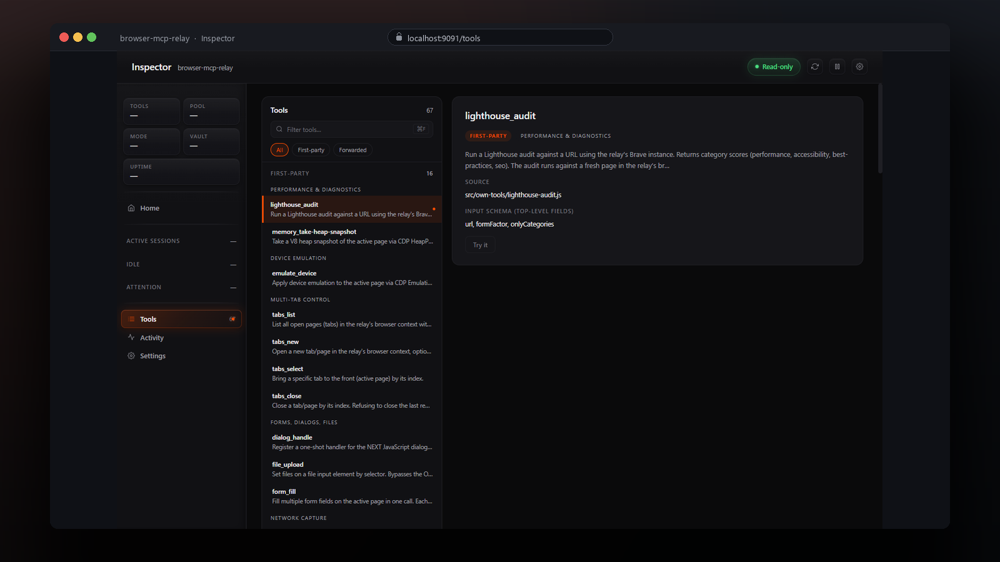

<div align="center">



# browser-mcp-relay

**Give your AI a real browser.**

[](./LICENSE)
[](#)
[](#)
[](docs/REFERENCE.md#tool-catalog)
[](docs/REFERENCE.md#platform-support)

</div>

---

## What this is

When you ask Claude or Cursor to *"check what's on this page"*, *"fill out this form"*, or *"run Lighthouse on production"* — your AI doesn't actually have a browser. It needs a tool that drives one.

`browser-mcp-relay` is that tool. It launches a real Brave browser on your computer, listens for instructions from your AI via the [Model Context Protocol](https://modelcontextprotocol.io/), and turns them into actual browser actions. Your AI gets **72 commands** ("tools") it can call; the relay does the work behind the scenes.

## What you can ask your AI to do

| | |
|---|---|
| 📸 **See pages** | Screenshots, full HTML, visible text, PDF export, ARIA tree |
| 🖱️ **Click around** | Buttons, links, dropdowns, drag-and-drop, hover, scroll, type |
| 📝 **Fill forms** | Single fields or 20 at once. File uploads with no OS picker. |
| 🔬 **Measure performance** | Lighthouse audits, Web Vitals, V8 heap snapshots |
| 📊 **Capture traffic** | Console logs, HTTP requests, XHR/fetch responses |
| 🍪 **Reuse your sessions** | Saved cookies + optional autofill, so logged-in pages just work |
| 💾 **Save outputs** | Capture downloads, record video, save heap snapshots |
| 🔍 **Extract data** | CSS-selector schema → JSON, even from authed pages |

For the full 72-tool catalog, see [`docs/REFERENCE.md`](docs/REFERENCE.md).

**22 specialist tools are hidden by default** to keep your AI's context lean: `debug` (JS debugger probes), `react` (component ↔ DOM lookup), `scenario` (saved multi-step scripts) and `trace` (OpenTelemetry trace ids). When a task would clearly benefit from one, your AI asks you first (clients with MCP elicitation also show you an approve/decline prompt), then turns it on with the `toolsets` tool. To keep a group on, set `BROWSER_RELAY_TOOLSETS=debug,react` (or `all`) in the relay's env or `local-config.json`. Details: [`docs/REFERENCE.md#toolsets`](docs/REFERENCE.md#toolsets).

## Quick start

```bash
git clone https://github.com/washedtl/browser-mcp-relay.git
cd browser-mcp-relay
npm install
npm run setup
```

The setup wizard:

1. Auto-detects your Brave install + profile dir
2. Writes a gitignored `local-config.json`
3. Runs a smoke test (spawns the relay with every toolset on, expects ≥60 tools; on Windows in broker mode, on a private pipe, and in legacy mode)
4. Prints a paste-ready snippet for your MCP client config

Paste the printed snippet into your MCP client's config file (`~/.claude.json` for Claude Code; `mcp.json` for Cursor) and restart the client. **Under two minutes on a clean machine.**

> 💡 The wizard never modifies your client's config directly — it only prints a snippet. You stay in control of where it lands.

To re-verify anytime:

```bash
npm run smoke
# → ✓ Relay healthy. 72 tools available (≥60). [broker, 3.5s]
# → ✓ Relay healthy. 72 tools available (≥60). [legacy, 2.2s]
```

## The Inspector

Optional read-only web UI at `localhost:9091` showing the live state of pool slots, the tool catalog, and a real-time feed of every `tools/call` your AI makes.

```bash
npm run inspector
```

In broker mode, set `BROWSER_RELAY_INSPECTOR_PORT` and the broker hosts the one Inspector for every session: live traffic from all of them, plus a **Broker** section with sessions, tabs and Brave.

| Page | What you see |
|---|---|
| **Pool overview** | Slot grid (claimed / idle / orphan), cookie freshness, vault summary |
| **Tools catalog** | All 72 tools with filter + per-tool detail |
| **Slot detail** | Live request/response feed with timing, args, and full payloads |
| **Activity history** | Cross-slot ring buffer of the last ~200 tool calls |
| **Settings** | Resolved config + paste-ready `local-config.json` snippet |

> ⚠️ **Treat the inspector port like it has your bearer tokens on it.** It binds to localhost only by default and has no auth. Tool-call payloads routinely contain auth tokens and authed-session URLs. Don't expose it via SSH tunnels or `0.0.0.0` unless you know what you're doing.

For inspector details (in-process vs standalone modes, security defenses, screenshot tour), see [`docs/REFERENCE.md#inspector`](docs/REFERENCE.md#inspector).

## How it works (in 30 seconds)

```
   Claude session 1 ──stdio──▶ shim ─┐
   Claude session 2 ──stdio──▶ shim ─┼─ named pipe ─▶ broker ──▶ ONE Brave, ONE profile
   Claude session N ──stdio──▶ shim ─┘                (51 forwarded + 21 own tools, one window per session)
```

**Broker mode is the default on Windows.** In 5 lines:

1. Each MCP session runs `node src/index.js`, which is now a ~23 MB shim.
2. The first shim starts a shared **broker** in the background, de-elevated when the session is elevated. The others join it over a per-user named pipe.
3. The broker runs one Brave on one persistent profile. Logins persist, and every session shares them live.
4. Each session gets its own window. Parallel subagents call `tabs_new` and pass the returned `tabId` so they don't share a tab.
5. If Brave crashes, the next call relaunches it. If the broker dies, the shims start a new one. Both happen without restarting the client. Brave closes after 20 idle minutes, and the broker exits 10 minutes after its last session.

On first start, the broker profile is seeded once from your freshest legacy pool profile, when you have one.

**Recovery:**
- `npm run broker:status` shows sessions, tabs and Brave.
- `npm run broker:stop` closes Brave cleanly and stops the broker. Open sessions start a fresh one on their next call.
- The log is `%LOCALAPPDATA%rowser-mcp-relayrokerroker.log`.
- **Fallback:** set `BROWSER_RELAY_MODE=legacy` (in the MCP server's `env`, or in `local-config.json`) to get the old one-relay-and-one-Brave-per-session model back. On macOS and Linux, legacy stays the default until the broker's unix-socket paths are verified.

The relay merges **51 upstream tools** from [`browser-devtools-mcp`](https://github.com/serkan-ozal/browser-devtools-mcp) with **21 of its own** into a single 72-tool MCP. Your AI doesn't know or care where each tool comes from — to it, it's just one MCP server.

For the full architecture deep-dive, configuration env vars, modes, optional features (proxy whitelist, credential vault, autofill), troubleshooting, and worked examples, see [`docs/REFERENCE.md`](docs/REFERENCE.md).

## Platform support

| | |
|---|---|
| 🪟 **Windows** | ✅ First-class — tested daily |
| 🍎 **macOS** | 🟡 Best-effort — written portably, not yet maintainer-verified |
| 🐧 **Linux** | 🟡 Best-effort — honors XDG, not yet maintainer-verified end-to-end |

## Limitations

- 📜 Upstream `browser-devtools-mcp` is **Elastic-2.0** licensed — permissive but not OSI-open-source. See [`THIRD_PARTY_NOTICES.md`](./THIRD_PARTY_NOTICES.md).
- 🦁 Requires Brave installed locally. Other Chromium browsers may work via `BROWSER_RELAY_BRAVE_PATH` but are untested.
- 🤝 **One broker serves every session** (broker mode): a hung tool or a crash affects all of them for a moment, and `execute` runs agent JavaScript inside that shared broker process. See [the known risks](docs/REFERENCE.md#broker-mode-known-risks).
- 🚧 Not in broker mode yet: the credential vault's autofill, authenticated proxies (`user:pass@`), `BROWSER_RELAY_IGNORE_HTTPS_ERRORS`. Use `BROWSER_RELAY_MODE=legacy` if you need them.

## Contributing

Bug reports and PRs welcome — see [`CONTRIBUTING.md`](./CONTRIBUTING.md). Adding a tool is one new file in `src/own-tools/` plus one registry entry; no upstream fork, no patch maintenance.

## License

MIT — see [`LICENSE`](./LICENSE). Direct-dependency licenses (including the Elastic-2.0 callout for upstream) are in [`THIRD_PARTY_NOTICES.md`](./THIRD_PARTY_NOTICES.md).

## Credits

Built on top of [`browser-devtools-mcp`](https://github.com/serkan-ozal/browser-devtools-mcp) by **Serkan Ozal** — the upstream that provides the 51 forwarded tools.

MCP itself is defined by Anthropic — see [modelcontextprotocol.io](https://modelcontextprotocol.io/).

---

<div align="center">

**Found a bug? [Open an issue](https://github.com/washedtl/browser-mcp-relay/issues).**

</div>
